# Thiết kế style video hook: chữ, chuyển cảnh, bố cục, màn đen

Tài liệu này quy định **video trông và chuyển động như thế nào**. Người dựng, hoặc AI agent điều khiển công cụ dựng video, chỉ cần làm theo là ra đúng bản thiết kế.

**Bộ file đi kèm:**

| File | Dùng để |
|---|---|
| `style/video-style.json` | **Nguồn chuẩn, máy đọc được.** Chứa toàn bộ thông số: màu, phông, cỡ chữ, vị trí từng dòng chữ (px), mốc thời gian, hiệu ứng, chuyển cảnh. Nếu tài liệu này và JSON khác nhau, **theo JSON**. |
| `style/wireframes/C01…C11.jpg` | Ảnh bố cục từng cảnh, vẽ từ JSON, chữ đặt đúng vị trí và đúng cỡ. `tong-quan.jpg` là ảnh gộp tất cả cảnh. |
| `kich-ban-loi-dan.md` | Lời dẫn theo cảnh C1–C11 |
| `thiet-ke-anh-minh-hoa.md` | Ảnh nền A01–A13 |
| `ke-hoach-san-xuat.md` | Quy trình sản xuất |
| `index.html` + `render.cjs` | Bộ dựng bản nháp. Có sẵn hiệu ứng chữ đánh máy, đường thời gian, tờ lịch lật, đồng hồ, chớp sáng, rung, có thể tham khảo để làm theo |

**Cách đọc wireframe:**
- **Khung nét đứt trắng** là vùng an toàn: chữ không được ra ngoài khung này.
- **Khung cam** là vùng trọng tâm của ảnh nền: không đặt chữ đè lên.
- **Nhãn xanh nhỏ** ghi tên phần tử, thời điểm xuất hiện và hiệu ứng.
- Thanh dưới mỗi ảnh ghi thời lượng cảnh, cách chuyển cảnh và chuyển động máy quay.

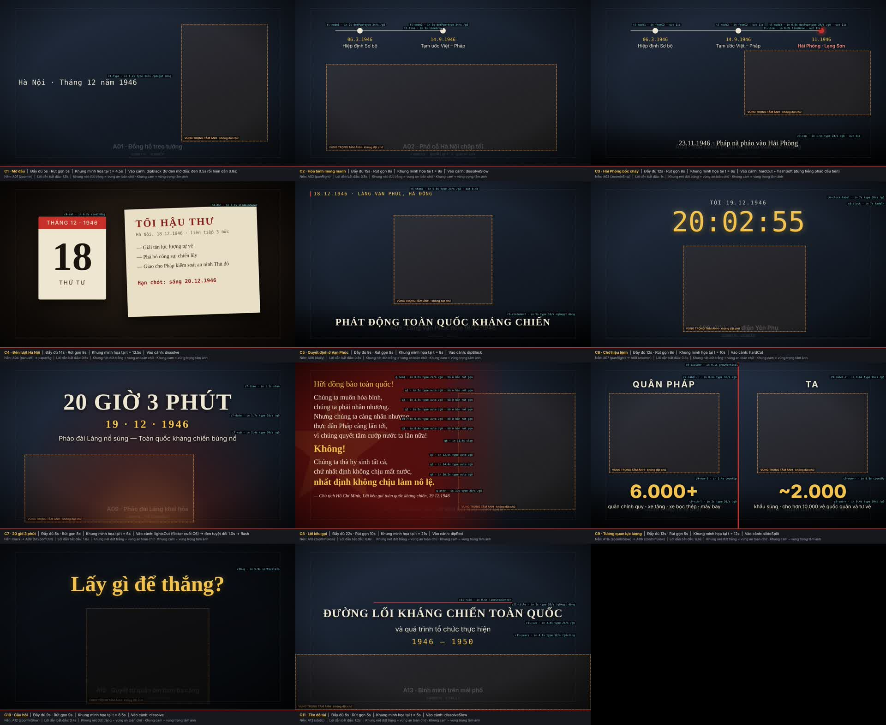

---

## 1. Bảy nguyên tắc thị giác

1. **Chữ hiện ra như ĐÁNH MÁY, luôn có TIẾNG GÕ PHÍM.** Mọi dòng chữ hiện từng ký tự như máy chữ năm 1946, có con trỏ vàng nhấp nháy, và **mỗi ký tự đi kèm một tiếng gõ phím**. Chỉ 4 ngoại lệ được liệt kê ở mục 5.1. Đây là "chữ ký" âm thanh và hình ảnh của cả video.
2. **Ảnh kể chuyện, chữ chỉ đánh dấu.** Chữ trên màn hình chỉ gồm ngày tháng, địa danh, con số, khẩu hiệu. **Không chép lại lời dẫn** lên màn hình. Lời dẫn chỉ hiện thành chữ trong bản có phụ đề.
3. **Mỗi lúc chỉ một điểm nhìn.** Cùng lúc chỉ có **1 khối chữ chính**, cộng tối đa 1 nhãn ngày tháng nhỏ. Đường thời gian ở C2–C3 là ngoại lệ duy nhất.
4. **Chậm và nặng.** Máy quay chuyển động chậm (tối đa 1,5% mỗi giây), chữ hiện mềm. Chỉ có hai lần cắt gắt, ở C3 (Hải Phòng) và C7 (20 giờ 3 phút), để tạo cú sốc.
5. **Tối là nền, sáng là điểm nhấn.** Tông xanh than đêm làm nền, vàng hổ phách làm điểm nhấn, đỏ dùng cho nguy hiểm, máu lửa, cao trào.
6. **Im lặng cũng là thiết kế.** Có đúng **1 giây đen và im lặng tuyệt đối** trước tiếng pháo ở C7. Đây là khoảnh khắc quan trọng nhất của video.
7. **Đúng lịch sử hơn đẹp.** Mọi chữ phải lấy **nguyên văn** từ `video-style.json`. Không tự thêm số liệu hay tên người.

---

## 2. Khung hình và vùng đặt chữ

- Khung hình **1920×1080**, **30 khung hình/giây**, chuẩn màu Rec.709. Xuất H.264 MP4.
- **Vùng an toàn chữ:** x từ 96 đến 1824, y từ 54 đến 1026. Tương đương cách mép trái phải 96 px, cách mép trên dưới 54 px.

```
 0                                                                  1920
 ┌───────────────────────────────────────────────────────────────────┐ 0
 │  ▌NGÀY · ĐỊA ĐIỂM  (stamp, góc trên trái, y=64)                    │
 │ ┌───────────────────────────────────────────────────────────────┐ │ 110
 │ │        DẢI TRÊN: đường thời gian, đồng hồ, nhãn chia đôi        │ │
 │ └───────────────────────────────────────────────────────────────┘ │ 350
 │ ┌───────────────────────────────────────────────────────────────┐ │ 360
 │ │   VÙNG GIỮA: tiêu đề lớn, câu hỏi (hoặc lên dải trên nếu        │ │
 │ │   trọng tâm ảnh nằm ở giữa hoặc dưới)                          │ │
 │ └───────────────────────────────────────────────────────────────┘ │ 720
 │                                                                   │
 │ ░░░░░░░░░░░░ dải tối (band) y 800–1080 khi có chú thích ░░░░░░░░░░ │ 800
 │     ┌───────────────────────────────────────────────────────┐     │ 860
 │     │  VÙNG DƯỚI: chú thích sự kiện, khẩu hiệu (căn giữa)     │     │
 │     └───────────────────────────────────────────────────────┘     │ 1000
 └───────────────────────────────────────────────────────────────────┘ 1080
   Cột trái (x 120–1160) dùng cho trích dẫn và chữ đánh máy, căn trái.
```

### Mỗi loại chữ đặt ở đâu

| Loại chữ | Vị trí | Căn | Ví dụ |
|---|---|---|---|
| Ngày tháng, địa điểm | Góc **trên trái** (x=96, y=64), có vạch đỏ nhỏ bên trái | Trái | `18.12.1946 · LÀNG VẠN PHÚC, HÀ ĐÔNG` |
| Đường thời gian, đồng hồ | **Dải trên** (y 110–350) | Giữa | Các mốc 1946; `20:02:55` |
| Chú thích sự kiện | **Vùng dưới** (y khoảng 900), luôn có dải tối phía sau | Giữa | `23.11.1946 · Pháp nã pháo vào Hải Phòng` |
| Khẩu hiệu cuối cảnh | Vùng dưới, có dải tối | Giữa | `PHÁT ĐỘNG TOÀN QUỐC KHÁNG CHIẾN` |
| Tiêu đề lớn, câu hỏi | **Giữa** hoặc **trên giữa** (khi trọng tâm ảnh ở dưới) | Giữa | `20 GIỜ 3 PHÚT`, `Lấy gì để thắng?` |
| Trích dẫn | **Cột trái** (x=120, rộng 1040), trên nền đỏ phủ dần | Trái | Lời kêu gọi |
| Số liệu so sánh | **Dưới mỗi nửa** màn hình chia đôi (y=770 và y=920) | Giữa nửa | `6.000+` và `~2.000` |

### Quy tắc vị trí

- **Không đặt chữ đè lên vùng trọng tâm ảnh** (khung cam trong wireframe). Chữ phải cách mép khung cam ít nhất 40 px.
- Nếu ảnh thật có bố cục khác thiết kế, **dời chữ theo cùng loại vùng**: chú thích vẫn ở dưới, chỉ dịch lên hoặc xuống. **Không đổi loại vùng.**
- Nền sau chữ rối mắt thì **phải có lớp làm tối**: dải tối ở đáy, lớp tối toàn khung, hoặc nền đỏ phủ dần. Không dùng viền chữ (stroke) để chữa cháy.

---

## 3. Màu sắc

| Tên | Mã | Dùng cho |
|---|---|---|
| Xanh than | `#0D1626`, `#1D2A40` | Nền đêm, ảnh tạm |
| Vàng | `#F2C14E` | Ngày tháng, đồng hồ, số liệu, câu hỏi, con trỏ đánh máy, dòng nhấn trong trích dẫn |
| Đỏ | `#C8302A` | Vạch kẻ, chấm mốc nguy hiểm, vạch chia đôi màn hình, vạch dưới tên đề tài |
| Đỏ sẫm | `#7A1414`, `#5A0D0B` | Nền trích dẫn, chuyển cảnh qua màu đỏ |
| Kem | `#EFE6D2` | Chữ chính |
| Hồng cam | `#FF8A7A` | Chữ của mốc "nguy hiểm" trên đường thời gian |
| Giấy, mực | `#E9DFC6`, `#2A1F16`, `#8A1F18` | Tờ tối hậu thư |

**Không dùng:** trắng tinh `#FFFFFF` cho chữ (chỉ dùng cho chớp sáng và phụ đề), các màu neon, màu xanh lá.

---

## 4. Chữ

### 4.1. Phông chữ

Cả ba phông đều miễn phí trên Google Fonts và có đủ dấu tiếng Việt. **Phải cài trước khi dựng**, nếu không dấu tiếng Việt sẽ bị vỡ.

| Vai trò | Phông chính | Phông dự phòng |
|---|---|---|
| Có chân (tiêu đề, trích dẫn, chú thích) | **Noto Serif** | Liberation Serif, Times New Roman |
| Không chân (nhãn, số liệu, dòng phụ) | **Be Vietnam Pro** | Inter, Arial |
| Đơn cách (ngày tháng, đồng hồ, chữ đánh máy) | **Noto Sans Mono** | DejaVu Sans Mono, Consolas |

### 4.2. Các kiểu chữ chính

Danh sách đầy đủ nằm trong `textStyles` của JSON.

| Kiểu | Phông · độ đậm · cỡ | Màu | Dùng ở |
|---|---|---|---|
| `titleXL` | Serif 700 · 150 px · IN HOA · giãn chữ 4 | Kem | `20 GIỜ 3 PHÚT` (C7) |
| `titleDate` | Serif 700 · 72 px · giãn chữ 10 | Vàng | `19 · 12 · 1946` (C7) |
| `titleL` | Serif 700 · 74 px · IN HOA · giãn chữ 3 | Kem | Tên đề tài (C11) |
| `statement` | Serif 700 · 64 px · IN HOA · giãn chữ 4 | Kem | `PHÁT ĐỘNG TOÀN QUỐC KHÁNG CHIẾN` (C5) |
| `question` | Serif 700 · 140 px | Vàng, có quầng sáng | `Lấy gì để thắng?` (C10) |
| `caption` | Serif 400 · 46 px · tối đa 2 dòng, 42 ký tự mỗi dòng | Kem, có bóng đổ | Chú thích sự kiện (C3, C4) |
| `stamp` | Mono 400 · 30 px · IN HOA · giãn chữ 4 · vạch đỏ 6 px bên trái | Vàng | Ngày tháng, địa điểm |
| `type` | Mono 400 · 46 px | Kem | Dòng đánh máy mở đầu (C1) |
| `quote` | Serif 400 · 44 px · giãn dòng 1,4 | Kem | Trích dẫn (C8) |
| `quoteNo` | Serif 700 · 64 px | Vàng | `Không!` |
| `quoteEmph` | Serif 700 · 58 px | Vàng | `nhất định không chịu làm nô lệ.` |
| `clockDigits` | Mono 400 · 180 px | Vàng, có quầng sáng | Đồng hồ đếm ngược (C6) |
| `number` | Sans 800 · 120 px | Vàng | `6.000+`, `~2.000` (C9) |
| `label` | Sans 700 · 56 px · IN HOA · giãn chữ 8 | Kem | `QUÂN PHÁP` / `TA` |
| `lack` | Sans 400 · 64 px | Kem | `Thiếu vũ khí.`… (C10) |

### 4.3. Quy tắc chữ

- **Cỡ chữ tối thiểu 30 px**, chú thích 46 px, để người ngồi cuối lớp vẫn đọc được trên máy chiếu.
- **IN HOA** chỉ dùng cho tiêu đề, nhãn và ngày tháng. Câu dài trên 5 từ không viết in hoa, trừ tên đề tài.
- **Thời gian chữ ở trên màn hình** tối thiểu bằng 1,5 giây cộng 0,25 giây cho mỗi tiếng. Ví dụ "Pháp nã pháo vào Hải Phòng" có 6 tiếng, cần ít nhất 3 giây.
- **Dấu tiếng Việt** không được bị cắt ở mép trên dòng. Nếu phông cắt dấu, tăng giãn dòng.
- Ngày tháng viết dạng `dd.mm.yyyy` (ví dụ `19.12.1946`). Dấu ngăn cách dùng `·` có khoảng trắng hai bên.

---

## 5. Cách chữ hiện ra (đọc kỹ)

### 5.1. Quy tắc gốc: chữ hiện ra như ĐÁNH MÁY và luôn có TIẾNG GÕ

**Mọi dòng chữ thông tin** đều hiện ra **như đang được gõ bằng máy chữ thời 1946**. Áp dụng cho ngày tháng, địa điểm, chú thích, mốc thời gian, tờ tối hậu thư, khẩu hiệu, trích dẫn, nhãn, dòng phụ và tên đề tài.

1. **Từng ký tự xuất hiện lần lượt** từ trái sang phải. Mỗi ký tự **hiện ra đột ngột**: không mờ dần, không trượt, không phóng to.
2. **Con trỏ `▌` màu vàng** đứng ngay sau ký tự cuối cùng. Con trỏ nhấp nháy 3 lần mỗi giây trong lúc gõ và tắt sau khi gõ xong 0,5 giây.
3. Khoảng cách giữa các ký tự **lệch ngẫu nhiên ±20%** để giống người gõ thật, không đều như máy.
4. **MỖI KÝ TỰ ĐI KÈM MỘT TIẾNG GÕ PHÍM MÁY CHỮ.** Đó là tiếng "tạch" khô và ngắn, phát **đúng khung hình** ký tự đó hiện ra.
   - Dấu cách dùng tiếng phím cách, trầm và nhẹ hơn.
   - Dòng nào trong JSON có `"returnSound": true` thì **cuối dòng có tiếng gạt cần xuống dòng "cạch… xoẹt"**.
   - Dòng nào có `"bell": true` thì **gõ xong có tiếng chuông "ting"** của máy chữ.
5. **Tốc độ gõ:**
   - Tiêu chuẩn: 26 ký tự/giây.
   - Nhấn mạnh, gõ chậm: 12–16 ký tự/giây (dòng mở đầu, khẩu hiệu, năm 1946 – 1950).
   - Dòng phụ, gõ nhanh: 30 ký tự/giây.
   - Tốc độ của từng dòng ghi trong JSON (`charsPerSecond`).

**Chỉ có 4 trường hợp KHÔNG đánh máy**, dùng để tạo cú đánh mạnh. Mỗi trường hợp có âm thanh riêng:

| Chữ | Cách hiện | Âm thanh |
|---|---|---|
| `20 GIỜ 3 PHÚT` (C7) | Cả dòng **đập vào** màn hình (`slam`), ngay sau chớp trắng | Tiếng **đại bác** nổ |
| `Không!` (C8) | Đập vào (`slam`), các dòng trước mờ xuống | Tiếng **"thịch" trầm**, đúng lúc giọng đọc nói "Không!" |
| `Lấy gì để thắng?` (C10) | Thu nhẹ từ 140% về 100% (`softScaleIn`) sau 0,5 s im lặng | Tiếng "thịch" trầm, nhẹ |
| Con số `6.000+`, `~2.000` (C9) | **Chạy số** từ 0 lên (`countUp`) | Tiếng **bộ đếm lách cách**, dừng bằng một tiếng "cạch" |

**Không có dòng chữ nào hiện ra trong im lặng.** Ngoại lệ duy nhất là tiêu đề và ngày tháng in sẵn trên tờ tối hậu thư: chúng xuất hiện cùng tờ giấy, đi kèm tiếng giấy trượt.

### 5.2. Tiếng gõ phím: thông số

| Mục | Quy định |
|---|---|
| Loại âm | Phím máy chữ cơ, lấy từ bản thu thật (xem dòng Nguồn). Không dùng tiếng bàn phím máy tính |
| Số mẫu | 12 tiếng phím khác nhau, **dùng luân phiên ngẫu nhiên**, lệch cao độ ±3% và âm lượng ±2 dB, để không nghe như tiếng máy lặp lại |
| Âm lượng | **−18 dB** khi không có lời dẫn (ví dụ dòng mở đầu C1, năm ở C11). **−28 dB** khi lời dẫn đang nói. **−30 dB** ở trích dẫn C8 (chỉ như tiếng nền, không được át giọng đọc) |
| Đồng bộ | Tiếng gõ khớp **từng ký tự**. Không dùng một đoạn tiếng gõ chạy liên tục không khớp với chữ |
| Nguồn | **Tiếng máy chữ cơ thật**, cắt từ bản thu `video-hook/audio/sfx/may-chu/goc/sea-you-later-typewriter-301419.mp3`. Các file đã cắt sẵn trong `video-hook/audio/sfx/may-chu/`: `phim-01…12.wav` (12 tiếng phím, tiếng "cạch" chính nằm ở 10 ms đầu file), `phim-cach-01…02.wav` (phím cách), `gat-dong-01…02.wav` (gạt dòng, bánh cóc chạy "rrrrt"), `chuong-01…02.wav` (chuông "ting"), `nghe-thu.wav` (nghe thử). **Không dùng tiếng tổng hợp hay tiếng bàn phím máy tính.** |
| Công cụ tạo sẵn tiếng gõ cho từng dòng | `python3 video-hook/audio/may_chu.py go "Hạn chót: sáng 20.12.1946" --cps 24 --bell -o han-chot.wav` tạo ra một file âm thanh có **đúng một tiếng gõ cho mỗi ký tự**, kèm tiếng gạt dòng (`--return`) hoặc chuông (`--bell`). Đi kèm là file `.json` ghi giây xuất hiện của từng ký tự. Dùng `--jitter 0` nếu công cụ dựng gõ chữ đều (ví dụ CapCut); mặc định nhịp gõ lệch ±20% cho giống người thật |

**Nếu công cụ dựng không tự gắn tiếng theo ký tự** (ví dụ CapCut: hiệu ứng "Đánh máy" không có âm thanh):
1. Thêm một **rãnh âm thanh riêng** tên "Gõ phím".
2. Với mỗi dòng chữ, chạy `may_chu.py go "<dòng chữ>" --cps <tốc độ> --jitter 0` để ra đoạn tiếng gõ **dài đúng bằng thời gian gõ** (số ký tự chia cho tốc độ gõ), rồi đặt đoạn đó vào rãnh "Gõ phím". Đầu đoạn trùng lúc ký tự đầu hiện ra.
3. Nếu dòng có tiếng gạt dòng hoặc chuông, đặt thêm tiếng đó ngay sau khi gõ xong.

### 5.3. Bảng các cách hiện chữ

Định nghĩa đầy đủ nằm trong `motionPresets` của JSON. Kiểu chuyển động chuẩn là nhanh lúc đầu, chậm dần về cuối (easeOut, `cubic-bezier(0.33, 1, 0.68, 1)`).

| Hiệu ứng | Mô tả bằng lời | Thông số | Âm thanh đi kèm | Dùng cho |
|---|---|---|---|---|
| `type` | **Đánh máy**, xem mục 5.1 | 12–30 ký tự/s | **Tiếng gõ phím mỗi ký tự** (bắt buộc), có thể thêm gạt dòng hoặc chuông | **Mặc định cho mọi dòng chữ** |
| `dotPop` + `type` | Chấm mốc phồng ra (0 → 115% → 100%), rồi ngày tháng và mô tả được đánh máy | 0,4 s + thời gian gõ | Một tiếng gõ to khi chấm hiện, sau đó tiếng gõ từng ký tự | Mốc đường thời gian |
| `slam` | Đập vào: từ 125% thu về 100% và hiện ra | 0,8 s | Đại bác (C7) hoặc tiếng thịch trầm (C8) | `20 GIỜ 3 PHÚT`, `Không!` |
| `softScaleIn` | Thu nhẹ từ 140% về 100% | 0,7 s | Tiếng thịch trầm, nhẹ | `Lấy gì để thắng?` |
| `countUp` | Số chạy từ 0 lên giá trị đích. Dấu chấm ngăn nghìn, giữ nguyên `~` và `+` | 1,2 s | Tiếng bộ đếm lách cách | Số liệu C9 |
| `flip` | Tờ lịch lật dọc, đổi số ở giữa động tác | 0,5 s | Tiếng lật giấy "phạch" | Lịch 17 → 18 |
| `slideInPaper` | Tờ giấy trượt từ phải vào, xoay từ +4° về −2° | 0,8 s | Tiếng giấy trượt | Tờ tối hậu thư |
| `riseInBig` | Khối hiện dần và trồi lên 60 px | 0,8 s | Không có | Tờ lịch |
| `lineGrow` | Vạch kẻ dài ra | 0,6–0,8 s | Không có (riêng C11 có tiếng trống) | Đường thời gian, vạch đỏ |
| `pulse` | Vòng đỏ lan ra quanh chấm, lặp lại | Chu kỳ 1,2 s | Không có | Mốc `11.1946` |
| `dimOthers` | Các dòng trước mờ xuống 55% | 0,4 s | Không có | Khi `Không!` xuất hiện |
| `clockTick` | Chữ số đồng hồ nảy nhẹ mỗi khi đổi giây | 0,25 s | Tiếng tích tắc | Đồng hồ C6 |
| `fadeOut` | **Cách biến mất mặc định:** mờ dần, không di chuyển | 0,4 s | Không có | Mọi chữ biến mất giữa cảnh |

### 5.4. Quy tắc chung

- Chữ biến mất **chỉ bằng mờ dần**, hoặc đi theo chuyển cảnh. **Không "xóa ngược" kiểu đánh máy**, không trượt ra.
- Không dùng nảy (bounce), xoay, chữ bay từng ký tự, hay hiệu ứng 3D.
- Hai dòng chữ không bắt đầu gõ cùng lúc. Dòng sau bắt đầu khi dòng trước đã gõ xong, hoặc cách ít nhất 0,2 s.
- Một dòng chữ phải **gõ xong trước khi lời dẫn nói xong ý đó**.

---

## 6. Chuyển động máy quay

Định nghĩa đầy đủ nằm trong `cameraPresets` của JSON.

| Kiểu | Thông số | Cảnh |
|---|---|---|
| `zoomIn` | Phóng từ 100% lên 108% suốt cảnh, tâm phóng là vùng trọng tâm ảnh | C1, A08 |
| `zoomInSlow` | Từ 100% lên 106% | C8, C9, C10 |
| `zoomInShip` | Từ 100% lên 112%, tâm là con tàu | C3 |
| `dolly` | Từ 100% lên 110%, tâm là khung cửa sáng | C5 |
| `panRight` / `panLeft` | Ảnh phóng sẵn 112%, lia 10% (hoặc 8%) bề rộng khung | C2, A07 / A04 |
| `hitZoomOut` | Rung 0,8 s, sau đó lùi từ 115% về 100% trong 3 s | C7 |
| `static` | Gần như đứng yên, từ 100% lên 102% | C11 |
| `parallax` | Chỉ khi ảnh có tách lớp. Các lớp chạy với tốc độ 0,3 / 0,6 / 1,0 | C2, A07 |

**Quy tắc máy quay:**
- Ảnh luôn phóng tối thiểu 104% để không lộ mép.
- Chuyển động máy quay kéo dài suốt cảnh, kể cả phần chồng lên chuyển cảnh, để hình không bị khựng.
- Không xoay khung hình. Mỗi ảnh chỉ một kiểu chuyển động.

---

## 7. Chuyển cảnh

### 7.1. Các kiểu chuyển cảnh

| Kiểu | Thông số | Ý nghĩa |
|---|---|---|
| `dissolve` | Hòa tan 0,8 s | **Mặc định**, mạch kể liền |
| `dissolveSlow` | Hòa tan 1,0 s | Đổi không khí nhẹ nhàng |
| `hardCut` | Cắt thẳng, đặt đúng nhịp tiếng động | Sốc, chuyển sang hành động |
| `flash` / `flashSoft` | Lớp trắng phủ khung, mờ về 0 trong 0,45 s (độ đậm 1,0) hoặc 0,35 s (độ đậm 0,6) | Tiếng nổ |
| `dipBlack` | Mờ ra đen 0,5 s, giữ đen 0,3 s, hiện vào 0,5 s | Sang "chương" mới |
| `dipRed` | Đi qua màu đỏ sẫm `#5A0D0B`: 0,4 s ra, 0,6 s vào | Vào Lời kêu gọi |
| `lightsOut` | Đèn trong ảnh chập chờn 0,8 s, rồi **cắt ngay sang đen tuyệt đối** | Đèn Hà Nội tắt |
| `slideSplit` | Hai nửa trượt vào từ hai bên trong 0,6 s, vạch đỏ giữa mọc ra từ tâm | Màn so sánh |
| `fadeToBlack` | Mờ về đen 1,5 s | Kết thúc |

**Không dùng:** gạt (wipe), xoay, lật 3D, phóng xuyên, glitch hay bất kỳ chuyển cảnh "trang trí" nào khác.

### 7.2. Bản đồ chuyển cảnh

```
[đen 0.5s] ─dipBlack─► C1 ─dissolveSlow─► C2 ─hardCut+flashSoft─► C3 ─dissolve─► C4 ─dipBlack─► C5
   ─hardCut─► C6 ─lightsOut─► [ĐEN 1.0s] ─flash─► C7 ─dipRed─► C8 ─slideSplit─► C9 ─dissolve─► C10
   ─dissolveSlow─► C11 ─fadeToBlack 1.5s─► [đen 1.0s]
```

**Chuyển cảnh bên trong một cảnh:**
- C4: từ ảnh A04 sang nền giấy bằng `dissolve`.
- C6: từ A07 sang A08 bằng `hardCut`.

---

## 8. Màn đen: khi nào và bao lâu

Mốc thời gian dưới đây tính theo bản đầy đủ.

| # | Thời điểm | Độ dài | Mô tả | Âm thanh |
|---|---|---|---|---|
| **Đen 1** | 0:00.0 – 0:00.5 | 0,5 s | Đen mở đầu, để máy chiếu kịp hiện hình | Tích tắc bắt đầu từ 0:00.3 |
| **Đen 2** | Khoảng 0:45.5 – 0:46.5 (từ C4 sang C5) | Giữ đen 0,3 s | `dipBlack`, ngắt "chương": từ đe dọa sang quyết định | Nhạc lắng |
| **Đen 3** | **1:07.0 – 1:08.0** (đầu C7) | **1,0 s** | **Đen tuyệt đối.** Không chữ, không nhiễu phim, không gì cả | Tiếng "tách", rồi **im lặng tuyệt đối**. Đến 1:08.0 thì đại bác nổ |
| **Đen 4** | 2:05.0 – 2:07.5 (sau C11) | 1,5 s mờ ra cộng 1,0 s giữ đen | Kết thúc, để người thuyết trình nói tiếp | Nhạc tắt theo |

**Quy tắc màn đen:**
- Ngoài 4 lần trên, **không có màn đen nào khác**. Giữa video, màn đen dài quá 1,2 giây sẽ khiến người xem tưởng video lỗi. Đen 3 là ngoại lệ vì có tiếng động dẫn dắt.
- Khung hình đen tuyệt đối phải là `#000000`, **tắt lớp nhiễu phim**, nếu không màn sẽ bị xám.
- C10 **không** dùng màn đen mà chỉ phủ lớp tối 60% lên ảnh. Người xem vẫn phải thấy người chiến sĩ phía sau.

---

## 9. Lớp phủ và hiệu ứng

| Lớp | Thông số | Khi nào |
|---|---|---|
| Nhiễu phim (`grain`) | Nhiễu đen trắng, độ đậm 5%, đổi mẫu mỗi 4 khung hình | Mọi lúc, **trừ** khung đen tuyệt đối |
| Viền tối (`vignette`) | Tối dần từ 55% bán kính ra mép, mép tối 60% | Mọi lúc |
| Dải tối đáy (`band`) | Chuyển từ đen 85% ở đáy lên trong suốt, y 800–1080, hiện hoặc tắt trong 0,5 s | Khi có chú thích hoặc khẩu hiệu ở vùng dưới |
| Lớp tối (`dim`) | Đen 60%, hiện trong 1 s | C10 |
| Nền đỏ phủ dần (`quoteScrim`) | Đỏ sẫm 96% ở mép trái, nhạt dần về trong suốt ở 72% bề rộng | C8 |
| Ngôi sao (`star`) | Sao vàng 5 cánh, độ đậm 8%, cỡ 820 px, xoay 2° mỗi giây | C8 |
| Quầng lửa (`explosionGlow`) | Quầng cam đỏ từ đáy khung, dao động rồi tắt dần trong 3 s | C7 |
| Rung (`shake`) | Lệch ngẫu nhiên tối đa ±18 px, giảm về 0 trong 0,8 s | C7, đúng khung hình tiếng nổ |
| Chập chờn (`flicker`) | Trong 0,8 s, mỗi khung có 35% khả năng ảnh tối xuống còn 15% | 0,8 s cuối C6 |
| Chớp sáng (`flash`) | Xem mục 7 | C3 (3 lần), C7 (1 lần) |

---

## 10. Đồng bộ âm thanh và hình

- **Chữ đi cùng lời:** chữ bắt đầu gõ cùng lúc hoặc sớm hơn lời tương ứng tối đa 0,3 s, và gõ xong trước khi lời nói xong ý đó.
- **Tiếng gõ phím khớp từng ký tự**, tự hạ xuống −28 dB khi có lời dẫn (−30 dB ở C8), không bao giờ át giọng nói. Xem mục 5.2.
- **Trích dẫn (C8):** mỗi dòng bắt đầu gõ **đúng lúc giọng đọc bắt đầu câu đó**. Tốc độ gõ bằng số ký tự chia cho 80% thời lượng câu nói, để chữ gõ xong trước lời. Các mốc trong JSON chỉ là ước tính, phải căn lại theo file `VO-C08` thật.
- **Tiếng nổ:** chớp sáng, rung và tiếng nổ phải nằm **cùng một khung hình**.
- **Cắt cảnh** đặt đúng nhịp tiếng động (C3, C6, C7) hoặc nhịp nhạc.
- **Kéo giãn cảnh:** nếu lời dẫn dài hơn kế hoạch, thời lượng cảnh bằng thời điểm lời bắt đầu, cộng độ dài lời, cộng 0,8 s. Phần dôi ra thêm vào cuối cảnh. Đồng hồ C6 và hiệu ứng chập chờn **neo theo cuối cảnh** (trường `"anchor": "end"` trong JSON), để 20:03:00 luôn trùng đúng lúc màn tắt đèn.
- **Âm lượng:**
  - Lời dẫn khoảng −16 LUFS.
  - Nhạc thấp hơn lời khoảng 12 dB khi có lời (nhạc hạ trong 0,2 s, trả lại trong 0,6 s).
  - Đỉnh tiếng không vượt −1 dBTP.


### 10.1. File âm thanh đã có sẵn

| Âm thanh | File (trong `video-hook/audio/sfx/`) | Dùng ở |
|---|---|---|
| Gõ phím máy chữ | `may-chu/phim-01…12.wav`, `may-chu/phim-cach-01…02.wav` | Mọi chữ đánh máy |
| Gạt dòng | `may-chu/gat-dong-01…02.wav` | Cuối các dòng có `returnSound` |
| Chuông "ting" | `may-chu/chuong-01…02.wav` | Các dòng có `bell` |
| **Đại bác** | `phao/universfield-powerful-cannon-shot-02-487887.mp3` | **C7 lúc 1,0 s**, cùng khung hình với chớp trắng và rung. **C3**, ba lần chớp sáng (cùng file, cùng âm lượng gốc) |
| **Súng: tràng bắn liên tiếp** | `sung/dragon-studio-gunshots-firing-repeatedly-511326.mp3` | **C7 lúc 1,8 s và 5,9 s** |
| **Súng máy** | `sung/freesound_community-clean-machine-gun-burst-98224.mp3` | **C7 lúc 4,1 s** |

Tất cả đều là **bản thu thật** do người làm video cung cấp.

**Tiếng máy chữ** đã được cắt và căn sẵn: tiếng "cạch" nằm ở **10 ms đầu file**. Khi dựng, đặt file **sớm hơn 10 ms** so với khung hình chữ hiện ra.

**Tiếng đại bác và tiếng súng dùng NGUYÊN FILE GỐC, ở MỌI cảnh (C3 và C7).** Tiếng đại bác giữ **âm lượng gốc** ở mọi lần xuất hiện. Không thêm vang, không lọc, không cắt, không ghép lại, vì xử lý làm mất lực của tiếng nổ. Chỉ được chỉnh **âm lượng** khi trộn.
- Tiếng nổ trong file gốc không bắt đầu ngay ở đầu file:
  - Đại bác: bắt đầu ở **85 ms**.
  - Tràng bắn liên tiếp: **23 ms**.
  - Súng máy: **25 ms**.
- Khi dựng, đặt file sớm hơn đúng khoảng đó so với khung hình chớp sáng. Ví dụ, đại bác ở C7 đặt file lúc 0,915 s để tiếng nổ trùng chớp trắng ở 1,000 s.
- Bản nghe thử cảnh C7 ghép đúng giờ từ ba file gốc: `video-hook/audio/sfx/nghe-thu-c7.wav`.
- Tiếng đại bác nặng về dải trầm. **Phải thử trên loa của lớp học hoặc máy chiếu**: nếu nghe không rõ thì tăng âm lượng, không thay file.
---

## 11. Diễn biến từng cảnh

Phần này viết cho người đọc. Vị trí px chính xác xem trong JSON và ảnh wireframe.
- Thời gian ghi theo dạng **đầy đủ / rút gọn**, tính từ đầu cảnh.
- **"Gõ"** nghĩa là chữ hiện ra như đánh máy, mỗi ký tự kèm một tiếng gõ phím máy chữ (mục 5.1).

### C1 · Mở đầu (5 s / 5 s)

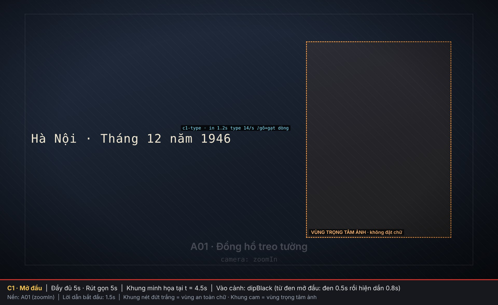

| Thời điểm | Hình và chữ | Âm thanh |
|---|---|---|
| 0,0 | Đen tuyệt đối | Tích tắc từ 0,3 s, mỗi giây một tiếng |
| 0,5 | Ảnh A01 hiện dần trong 0,8 s, máy quay `zoomIn` về phía đồng hồ (bên phải) | — |
| 1,2 | **Gõ chậm** (14 ký tự/s) `Hà Nội · Tháng 12 năm 1946` ở nửa trái (x=120, y=510), có con trỏ vàng | **Tiếng gõ phím rõ** (−16 dB), là âm thanh đầu tiên sau tiếng tích tắc. Cuối dòng có tiếng gạt dòng "cạch… xoẹt" |
| 1,5 | — | Lời dẫn bắt đầu. Tiếng gõ hạ xuống −28 dB |

### C2 · Hòa bình mong manh (15 s / 8 s)

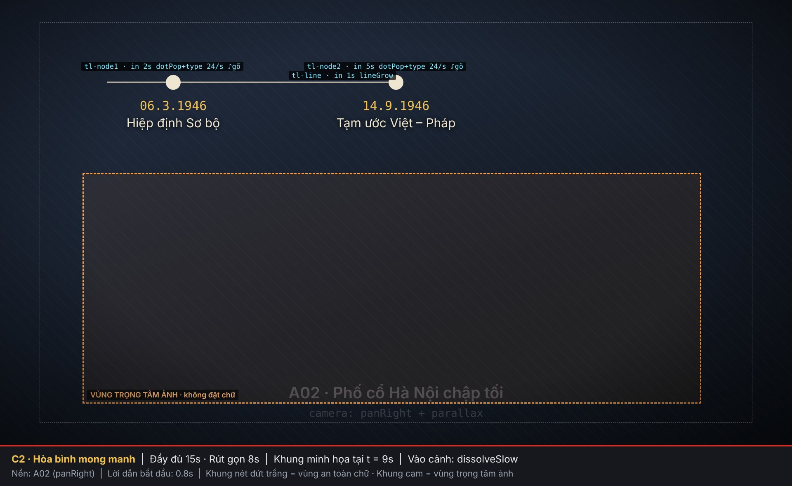

| Thời điểm | Hình và chữ | Âm thanh |
|---|---|---|
| 0,0 | Hòa tan 1 s vào A02, máy quay `panRight`, có parallax nếu ảnh tách lớp | Nhạc 1 vào dần |
| 1,0 / 0,6 | Vạch thời gian (dải trên, y=198) dài ra tới mốc 1 | — |
| 2,0 / 1,2 | Chấm mốc 1 phồng ra, rồi **gõ** `06.3.1946` và `Hiệp định Sơ bộ` | Một tiếng gõ to khi chấm hiện, sau đó tiếng gõ từng ký tự (−28 dB) |
| 4,0 / 2,4 | Vạch dài tới mốc 2 | — |
| 5,0 / 3,0 | Chấm mốc 2, rồi **gõ** `14.9.1946` và `Tạm ước Việt – Pháp` | Như mốc 1 |
| Cuối cảnh | Đường thời gian **giữ nguyên** sang C3, không mờ đi | — |

### C3 · Hải Phòng bốc cháy (12 s / 8 s)

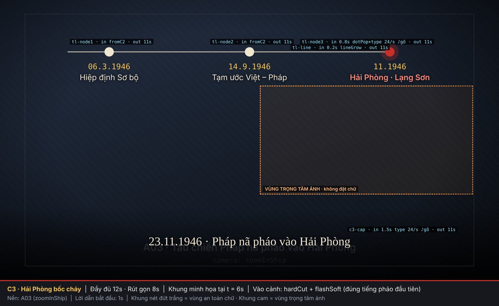

| Thời điểm | Hình và chữ | Âm thanh |
|---|---|---|
| 0,0 | **Cắt thẳng** sang A03, kèm chớp trắng nhẹ (`flashSoft`). Máy quay `zoomInShip` | **Tiếng đại bác** (file gốc, âm lượng gốc; đặt file sớm 85 ms) |
| 0,2 | Vạch thời gian dài tới mốc 3 | — |
| 0,8 | Chấm **đỏ** phồng ra, rồi **gõ** `11.1946` và `Hải Phòng · Lạng Sơn` (chữ hồng cam). Chấm đỏ lan vòng liên tục | Tiếng gõ (−28 dB) |
| 1,5 / 1,2 | Dải tối ở đáy hiện. **Gõ** `23.11.1946 · Pháp nã pháo vào Hải Phòng` (24 ký tự/s) | Tiếng gõ (−28 dB) |
| 3,0 / 2,5 và 7,0 / 5,0 | Chớp sáng | **Tiếng đại bác** (file gốc, âm lượng gốc) |
| 11,0 / 7,0 | Đường thời gian và chú thích mờ đi | — |

### C4 · Đến lượt Hà Nội (14 s / 9 s). Bản rút gọn bỏ phần A.

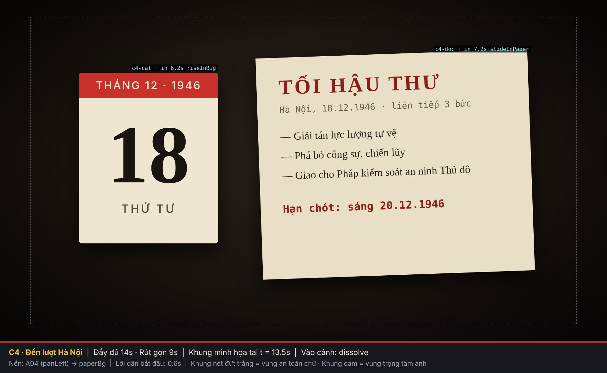

**Phần A** (chỉ có ở bản đầy đủ):

| Thời điểm | Hình và chữ | Âm thanh |
|---|---|---|
| 0–6 | A04, máy quay `panLeft` | Tiếng xích xe bọc thép từ xa |
| 0,8 | Dải tối hiện. **Gõ** `17.12.1946 · Thảm sát phố Yên Ninh, Hàng Bún` | Tiếng gõ (−28 dB) |
| 5,4 | Chú thích mờ đi | — |

**Phần B** (nền giấy tối, không cần ảnh):

| Thời điểm | Hình và chữ | Âm thanh |
|---|---|---|
| 6,0 / 0,0 | Hòa tan sang nền giấy | — |
| 6,2 / 0,2 | Tờ lịch trồi lên ở bên trái | — |
| 6,8 / 0,8 | Lịch lật từ `17 · THỨ BA` sang `18 · THỨ TƯ` | Tiếng lật giấy "phạch" |
| 7,2 / 1,2 | Tờ tối hậu thư trượt vào từ bên phải, nghiêng −2°. Tiêu đề `TỐI HẬU THƯ` và dòng ngày tháng in sẵn trên giấy | Tiếng giấy trượt |
| 7,9 / 1,9 | **Gõ** `— Giải tán lực lượng tự vệ` (30 ký tự/s) | Tiếng gõ, cuối dòng tiếng gạt dòng |
| 9,0 / 3,0 | **Gõ** `— Phá bỏ công sự, chiến lũy` | Tiếng gõ và gạt dòng |
| 10,1 / 4,1 | **Gõ** `— Giao cho Pháp kiểm soát an ninh Thủ đô` | Tiếng gõ và gạt dòng |
| 11,7 / 5,7 | **Gõ** dòng đỏ đậm `Hạn chót: sáng 20.12.1946` (24 ký tự/s), rồi giữ yên đến hết cảnh | Tiếng gõ to hơn. **Gõ xong có tiếng chuông "ting"** |

### C5 · Quyết định ở Vạn Phúc (9 s / 9 s)

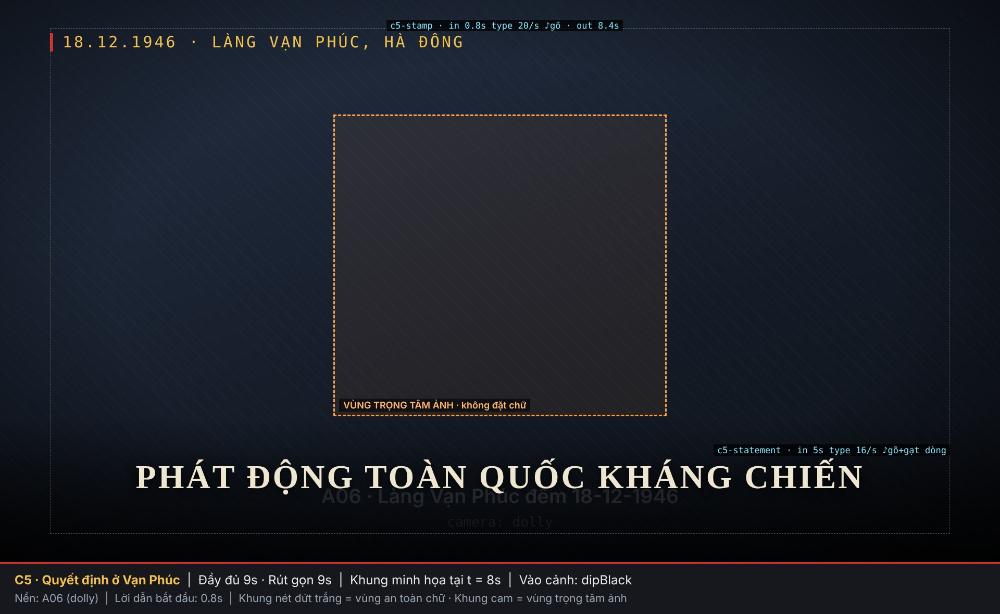

| Thời điểm | Hình và chữ | Âm thanh |
|---|---|---|
| 0,0 | Vào bằng `dipBlack`. A06, máy quay `dolly` về phía khung cửa sáng | Tiếng dế, nhạc lắng |
| 0,8 | Vạch đỏ nhỏ hiện ở góc trên trái, rồi **gõ** `18.12.1946 · LÀNG VẠN PHÚC, HÀ ĐÔNG` (20 ký tự/s) | Tiếng gõ (−28 dB) |
| 5,0 | Dải tối ở đáy hiện. **Gõ chậm** (16 ký tự/s) khẩu hiệu `PHÁT ĐỘNG TOÀN QUỐC KHÁNG CHIẾN`, từng chữ nặng nề như đang gõ một mệnh lệnh | Tiếng gõ rõ (−20 dB), cuối dòng tiếng gạt dòng |
| 8,4 | Dòng ngày tháng mờ đi | — |

### C6 · Chờ hiệu lệnh (12 s / 8 s)

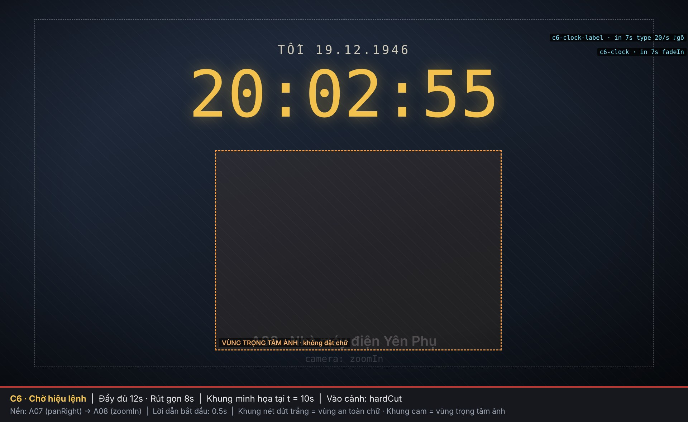

| Thời điểm | Hình và chữ | Âm thanh |
|---|---|---|
| 0,0 | **Cắt thẳng** sang A07, máy quay `panRight` | — |
| 0,6 / 0,4 | **Gõ** `TỐI 19.12.1946` ở góc trên trái | Tiếng gõ |
| 5,6 / 2,8 | Dòng ngày tháng mờ đi | — |
| 6,0 / 3,0 | **Cắt thẳng** sang A08, máy quay `zoomIn` về phía cầu dao | — |
| Cuối cảnh − 5 s | **Gõ nhanh** nhãn `TỐI 19.12.1946` ở dải trên. Chữ số `20:02:55` hiện dần trong 0,4 s, rồi đổi từng giây, mỗi lần nảy nhẹ | Tiếng gõ cho nhãn. Mỗi giây một tiếng tích tắc, to dần |
| Cuối cảnh − 1 s | — | Nhạc tắt hẳn |
| Cuối cảnh − 0,8 s | Ảnh chập chờn (`flicker`) | Tiếng điện rè |
| Cuối cảnh | Đồng hồ vừa chạm `20:03:00` thì **cắt sang đen** | — |

### C7 · 20 giờ 3 phút (8 s / 8 s)

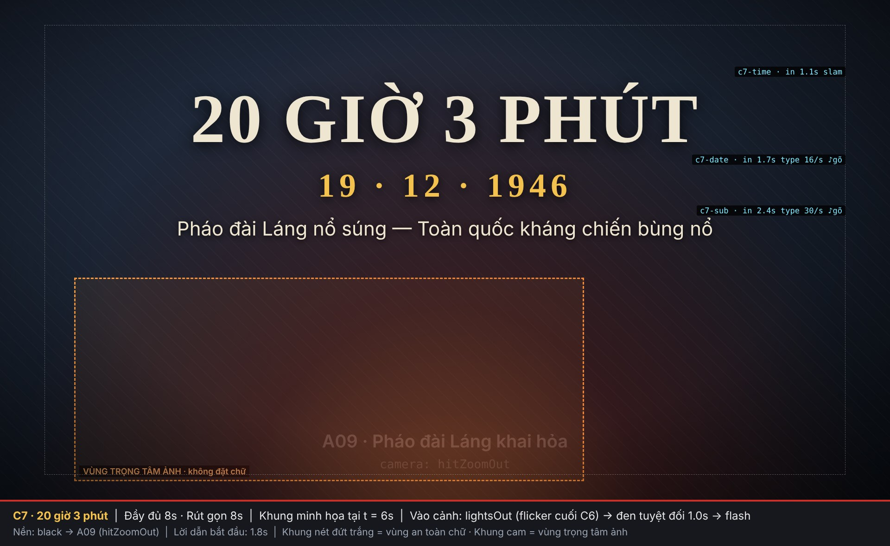

| Thời điểm | Hình và chữ | Âm thanh |
|---|---|---|
| 0,0 – 1,0 | **ĐEN TUYỆT ĐỐI** | Tiếng "tách" của cầu dao, rồi **im lặng tuyệt đối** |
| 1,0 | Chớp trắng (`flash`), rung (`shake`), ảnh A09 với `hitZoomOut`, quầng lửa đáy khung. `20 GIỜ 3 PHÚT` **đập vào** màn hình (`slam`, không đánh máy) ở **nửa trên** (y=170) | **ĐẠI BÁC** nổ và vang |
| 1,7 | **Gõ** `19 · 12 · 1946` màu vàng (16 ký tự/s) | Tiếng gõ (−18 dB), nghe rõ trên tiếng vang đại bác đang tắt |
| 1,8 | — | **Súng nổ ran** (file gốc): tràng bắn liên tiếp lúc 1,8 s, súng máy lúc 4,1 s, tràng bắn liên tiếp lúc 5,9 s. Lời dẫn bắt đầu, tiếng súng hạ xuống 6 dB cho khỏi át lời |
| 2,4 | **Gõ nhanh** (30 ký tự/s) `Pháo đài Láng nổ súng — Toàn quốc kháng chiến bùng nổ` | Tiếng gõ (−28 dB) |

### C8 · Lời kêu gọi (22 s / 10 s)

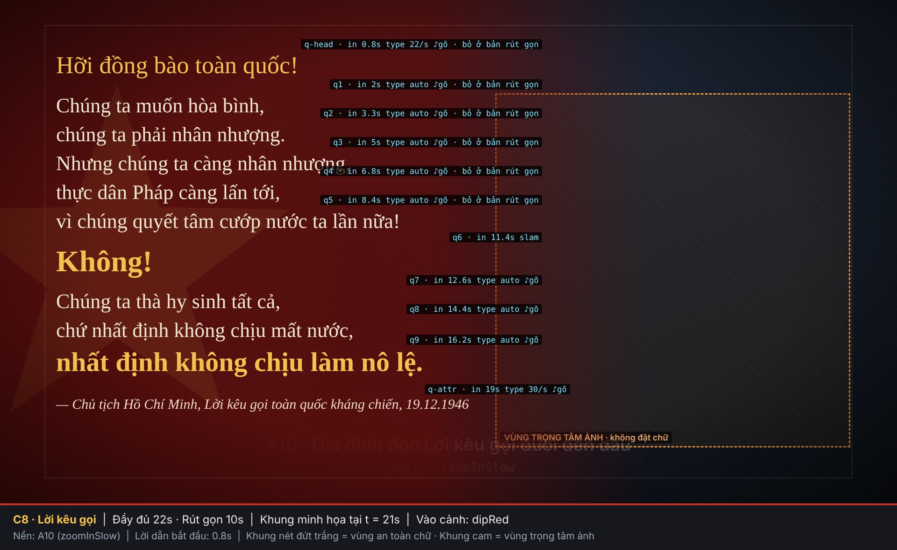

| Thời điểm | Hình và chữ | Âm thanh |
|---|---|---|
| 0,0 | Đi qua màu đỏ (`dipRed`) vào A10. Nền đỏ phủ dần từ trái, ngôi sao mờ xoay chậm | Tràng súng cuối của C7 tự tắt trong khoảng 0,2 s đầu. Nhạc 2 vào |
| 0,8 | **Gõ** `Hỡi đồng bào toàn quốc!` màu vàng | Tiếng gõ **rất nhỏ** (−30 dB) |
| 2,0 → 8,4 | Năm dòng đầu được **gõ khớp với giọng đọc**: mỗi dòng bắt đầu gõ đúng lúc giọng đọc bắt đầu câu đó, gõ xong trước khi giọng đọc hết câu | Tiếng gõ rất nhỏ (−30 dB), không được át giọng đọc |
| 11,4 / 0,8 | `Không!` **đập vào** (`slam`, không đánh máy). Các dòng trước mờ xuống 55% | Tiếng **"thịch" trầm**, đúng lúc giọng đọc nói "Không!" |
| 12,6 → 16,2 / 1,8 → 5,4 | **Gõ** ba dòng cuối khớp giọng đọc. Dòng `nhất định không chịu làm nô lệ.` màu vàng, chữ to hơn | Tiếng gõ rất nhỏ (−30 dB) |
| 19,0 / 8,0 | **Gõ nhanh** dòng ghi nguồn, chữ nghiêng | Tiếng gõ rất nhỏ |
| Bản rút gọn | Chỉ có từ `Không!` trở đi. Khối chữ được dời lên giữa khung (xem `yShort` trong JSON) | — |

### C9 · Tương quan lực lượng (13 s / 5 s)

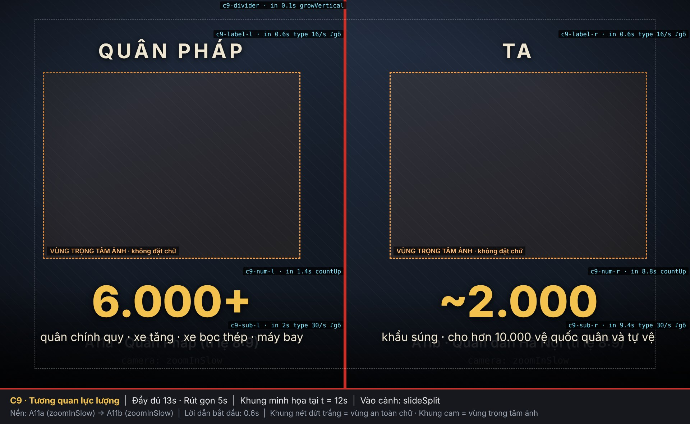

| Thời điểm | Hình và chữ | Âm thanh |
|---|---|---|
| 0,0 | `slideSplit`: A11a trượt từ trái, A11b trượt từ phải, vạch đỏ giữa mọc ra | Tiếng gió lướt nhẹ. Tim đập bắt đầu |
| 0,6 / 0,5 | **Gõ** `QUÂN PHÁP` và `TA` ở dải trên mỗi nửa (16 ký tự/s) | Tiếng gõ (−24 dB) |
| 1,4 / 0,8 | `6.000+` **chạy số** (`countUp`, không đánh máy) | Tiếng bộ đếm lách cách, dừng bằng "cạch" |
| 2,0 / 1,2 | **Gõ nhanh** `quân chính quy · xe tăng · xe bọc thép · máy bay` | Tiếng gõ |
| 8,8 / 2,0 | `~2.000` **chạy số** | Tiếng bộ đếm |
| 9,4 / 2,5 | **Gõ nhanh** `khẩu súng · cho hơn 10.000 vệ quốc quân và tự vệ` | Tiếng gõ |

Thông điệp của cảnh: phía ta đông người hơn, nhưng **cứ 5 người mới có 1 khẩu súng**.

### C10 · Câu hỏi (9 s / 9 s)

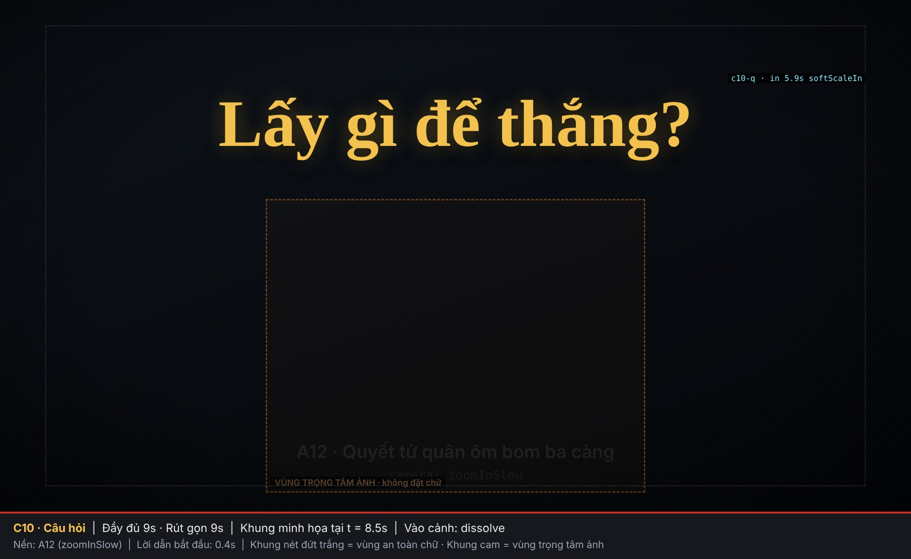

| Thời điểm | Hình và chữ | Âm thanh |
|---|---|---|
| 0,0 | Hòa tan vào A12, lớp tối hiện lên 60% trong 1 s | Tim đập tiếp |
| 0,6 / 1,6 / 2,6 | Ở dải trên lần lượt **gõ** `Thiếu vũ khí.`, `Kinh tế kiệt quệ.`, `Không một nước nào công nhận.` (22 ký tự/s, khớp lời dẫn) | Tiếng gõ (−24 dB), cuối mỗi dòng tiếng gạt dòng |
| 5,0 | Cả ba dòng mờ đi | — |
| 5,4 | — | Tim đập **dừng**, im lặng hoàn toàn 0,5 s |
| 5,9 | `Lấy gì để thắng?` hiện bằng `softScaleIn` (không đánh máy), màu vàng, 140 px, ở trên giữa | Tiếng "thịch" trầm, nhẹ, cùng lời dẫn "Vậy… lấy gì để thắng?" |

### C11 · Tên đề tài (6 s / 5 s), sau đó là phần kết

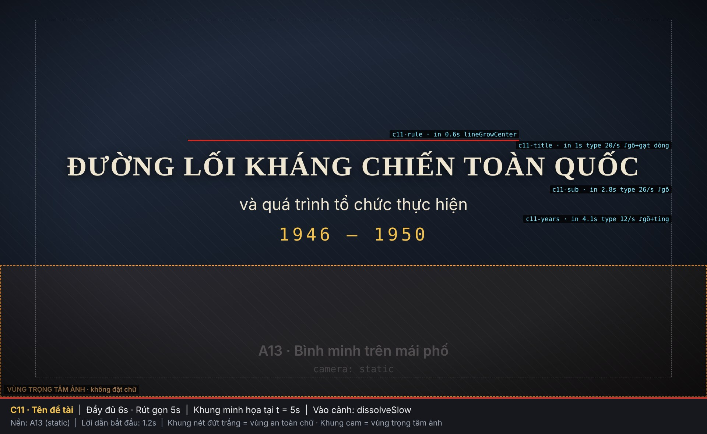

| Thời điểm | Hình và chữ | Âm thanh |
|---|---|---|
| 0,0 | Hòa tan chậm vào A13, gần như đứng yên | — |
| 0,6 / 0,4 | Vạch đỏ dài ra từ tâm | Tiếng **trống lớn** |
| 1,0 / 0,7 | **Gõ** `ĐƯỜNG LỐI KHÁNG CHIẾN TOÀN QUỐC` (20 ký tự/s) | Tiếng gõ rõ (−18 dB), cuối dòng tiếng gạt dòng |
| 2,8 / 2,3 | **Gõ** `và quá trình tổ chức thực hiện` | Tiếng gõ (−20 dB) |
| 4,1 / 3,6 | **Gõ chậm** (12 ký tự/s) `1946 – 1950` màu vàng | Tiếng gõ rõ (−16 dB). **Gõ xong có chuông "ting"** |
| Hết cảnh | `fadeToBlack` 1,5 s, giữ đen 1 s | Nhạc tắt theo |

---

## 12. Bản rút gọn khác gì

- Các phần tử có `"short": false` trong JSON bị **bỏ**. Phần tử có `tShort` hoặc `yShort` dùng **mốc hoặc vị trí riêng** của bản rút gọn.
- Các thay đổi chính:
  - C4 bỏ phần A (ảnh A04 và chú thích thảm sát).
  - C8 chỉ giữ từ `Không!` trở đi.
  - C9 rút còn 5 s và không có lời.
- **Tổng thời lượng:** bản đầy đủ khoảng **2:07,5**, bản rút gọn khoảng **1:26,5** (đã tính phần đen kết thúc).

---

## 13. Những điều cấm

- ❌ **Chữ hiện ra mà không có tiếng gõ phím**, hoặc tiếng gõ chạy lệch so với chữ.
- ❌ Chữ thông tin hiện bằng mờ dần hay trượt thay vì đánh máy (trừ 4 ngoại lệ ở mục 5.1).
- ❌ Dùng tiếng bàn phím máy tính thay cho tiếng máy chữ cơ.
- ❌ Chữ đè lên mặt người hoặc vùng trọng tâm ảnh.
- ❌ Chép lời dẫn lên màn hình (trừ bản có phụ đề).
- ❌ Chuyển cảnh kiểu gạt, xoay, 3D, glitch. Chữ nảy, xoay, bay.
- ❌ Màn đen ngoài 4 lần đã quy định, hoặc màn đen có nhiễu phim.
- ❌ Chữ trắng tinh, màu neon, viền chữ dày.
- ❌ Tự thêm hoặc sửa số liệu, ngày tháng, câu trích. Mọi chữ lấy **nguyên văn** từ JSON.
- ❌ Dùng phông không có dấu tiếng Việt, hoặc để phông tự thay thế làm lệch dấu.
- ❌ Nhạc hoặc hiệu ứng âm thanh có bản quyền mà không rõ nguồn.

---

## 14. Gợi ý thực hiện theo từng công cụ

| Công cụ | Cách làm tương ứng |
|---|---|
| **CapCut (máy tính)** | **Chữ:** hiệu ứng vào "Đánh máy" (Typewriter) cho `type`. **Hiệu ứng này không có âm thanh**, nên phải thêm rãnh âm thanh "Gõ phím" riêng, đặt đoạn tiếng gõ dài đúng bằng thời gian gõ của từng dòng (xem mục 5.2); "Mờ dần" (Fade in) cho `fadeIn`; "Trượt lên" cho `riseIn`. **Máy quay:** đặt keyframe Scale và Position cho zoom/lia (ví dụ Scale 100% → 108%). **Chuyển cảnh:** "Hòa trộn" (Mix/Dissolve), "Đen" (Black fade) cho `dipBlack`, "Chớp trắng" (Flash) cho `flash`. **Hiệu ứng:** "Rung" (Shake), "Hạt phim" (Film grain), "Viền tối" (Vignette). Tên hiệu ứng có thể khác theo phiên bản, hãy chọn hiệu ứng gần nhất rồi chỉnh thời lượng theo bảng ở mục 5 và 7. |
| **Premiere Pro / After Effects** | Easy Ease Out gần với `easeOut`. Preset Typewriter cho `type`. Rung: biểu thức `wiggle(30, 18*Math.max(0,1-(time-inPoint)/0.8))`. Đếm số: Slider Control kết hợp `Math.round`. Chuyển cảnh: Cross Dissolve, Dip to Black, Dip to White. |
| **DaVinci Resolve** | Text+ trong Fusion với Write On. Transform keyframe cho máy quay. Cross Dissolve và Dip To Color Dissolve (đen, đỏ `#5A0D0B`). |
| **Remotion (React)** | Mỗi cảnh là một `<Sequence>`. Dùng `interpolate()` với `Easing.bezier(0.33, 1, 0.68, 1)`. Đọc thẳng `video-style.json` để lấy vị trí, mốc thời gian, kiểu chữ. |
| **Python (MoviePy) / ffmpeg** | Ken Burns bằng `zoompan`. Chuyển cảnh bằng `xfade` (`fade`, `fadeblack`, `fadewhite`). Chữ tiếng Việt nên vẽ bằng Pillow với file `.ttf`. Hạ nhạc khi có lời bằng `sidechaincompress`, chuẩn hóa âm lượng bằng `loudnorm`. |
| **Bộ dựng có sẵn trong repo** | `index.html` cộng `render.cjs` (HTML, Playwright, ffmpeg). Đã có sẵn đánh máy, đường thời gian, tờ lịch, đồng hồ, chớp sáng, rung, nhiễu phim. Có thể mở rộng để đọc `video-style.json` |

---

## 15. Danh sách nghiệm thu

- [ ] Thời lượng: đầy đủ khoảng 2:07 (sai lệch ±3 s) hoặc rút gọn khoảng 1:26 (±3 s)
- [ ] Mọi chữ đúng nguyên văn JSON, đủ dấu tiếng Việt, không bị cắt dấu
- [ ] Mọi dòng chữ (trừ 4 ngoại lệ) hiện ra như **đánh máy**, có con trỏ vàng, và **có tiếng gõ phím khớp từng ký tự**. Có tiếng gạt dòng và chuông ở đúng các dòng quy định
- [ ] Tiếng gõ không át lời dẫn
- [ ] Không có chữ nằm ngoài vùng an toàn hoặc đè lên vùng trọng tâm ảnh
- [ ] Đúng 4 màn đen. Màn đen 1,0 s ở đầu C7 là đen tuyệt đối và im lặng
- [ ] Đồng hồ chạm `20:03:00` đúng khung hình tắt đèn
- [ ] Chớp sáng, rung và tiếng nổ cùng khung hình (C3, C7)
- [ ] Trích dẫn gõ khớp với giọng đọc
- [ ] Nhạc không lấn lời; đỉnh tiếng không vượt −1 dBTP
- [ ] Xuất MP4 H.264 1920×1080, 30 khung hình/giây, âm thanh AAC 192 kbps; cộng thêm bản 720p để xem trước

---

## 16. Lời nhắn mẫu để giao việc cho AI agent

Dán đoạn sau cho agent trên máy khác. Sửa đường dẫn cho đúng máy đó.

```
Bạn là người dựng video. Hãy dựng video hook (16:9, 1920x1080, 30fps) cho bài thuyết trình
"Đường lối kháng chiến toàn quốc và quá trình tổ chức thực hiện (1946–1950)".

Đọc theo thứ tự:
1. video-hook/style/thiet-ke-style-video.md   (quy tắc style, BẮT BUỘC tuân thủ)
2. video-hook/style/video-style.json          (thông số chuẩn: vị trí, mốc thời gian, chữ, hiệu ứng)
3. video-hook/style/wireframes/*.jpg          (bố cục từng cảnh)
4. video-hook/kich-ban-loi-dan.md             (lời dẫn từng cảnh)

Tư liệu:
- Ảnh nền: video-hook/assets/A01…A13 (mã ảnh khớp trường "asset" trong JSON).
  Ảnh nào chưa có thì dùng nền xanh than #0D1626 kèm chuyển động máy quay như thiết kế.
- Lời dẫn: video-hook/audio/vo/VO-C01…VO-C11. Nhạc: video-hook/audio/music/. Hiệu ứng âm thanh: video-hook/audio/sfx/ (danh sách mã SFX-... ở mục sfxLibrary trong JSON).
- Phông: cài Noto Serif, Be Vietnam Pro, Noto Sans Mono (Google Fonts) trước khi dựng.

Yêu cầu:
- Dựng bản [RÚT GỌN | ĐẦY ĐỦ] theo JSON. Bản rút gọn: bỏ phần tử "short": false, dùng tShort / yShort.
- Mọi chữ trên màn hình lấy NGUYÊN VĂN từ JSON. Không thêm chữ, không sửa số liệu.
- Căn mốc trích dẫn ở C8 theo file VO-C08 thật. Đồng hồ C6 neo theo cuối cảnh.
- MỌI dòng chữ hiện ra NHƯ ĐÁNH MÁY (từng ký tự, con trỏ ▌ vàng nhấp nháy) và MỖI KÝ TỰ CÓ MỘT TIẾNG GÕ PHÍM MÁY CHỮ
  (xem mục 5.1–5.2; 4 ngoại lệ: "20 giờ 3 phút", "Không!", "Lấy gì để thắng?", các con số đếm).
  Thêm tiếng gạt dòng / chuông ở các dòng có returnSound / bell trong JSON.
- Tuân thủ mục 8 (màn đen) và mục 13 (những điều cấm).
- Xuất: out/hook.mp4 (H.264, AAC 192k) và out/hook-720p.mp4.

Khi xong:
- Chụp 1 khung hình giữa mỗi cảnh (11 ảnh) để đối chiếu với wireframe.
- Đi qua danh sách nghiệm thu ở mục 15.
- Báo lại những chỗ đã phải làm khác thiết kế và lý do.
```
